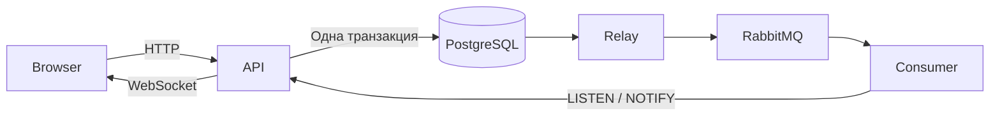

# Контур

Веб-мессенджер на FastAPI с PostgreSQL, RabbitMQ и браузерным клиентом.

## Запуск

Нужны Docker и Docker Compose v2.

```sh
docker compose up --build -d
```

Интерфейс открывается на [localhost:8000](http://localhost:8000), документация API — на [localhost:8000/docs](http://localhost:8000/docs). Зарегистрируйте два аккаунта в разных профилях браузера, затем найдите один аккаунт из другого по логину. Для записи голосовых и видеокружков браузеру нужны разрешения на микрофон и камеру. Используйте localhost или HTTPS.

PostgreSQL и RabbitMQ используют именованные тома. API слушает loopback. Для HTTPS за обратным прокси задайте `SECURE_COOKIES=1` и `PUBLIC_ORIGIN`, например `https://chat.example.org`. Значения переменных перечислены в `.env.example`. Для паролей контейнеров используйте символы, допустимые в URL, или передайте экранированные строки подключения через собственную Compose-конфигурацию.

## Возможности

- Регистрация по логину и паролю, сессии в HttpOnly cookie, поиск собеседников.
- Личные диалоги, закрытые группы, каналы и личное «Избранное». Каналы по умолчанию принимают публикации владельца и администраторов.
- Текст, фото, видео, файлы до 25 МБ, голосовые и видеокружки. Браузер записывает аудио и видео через MediaRecorder и показывает предпросмотр перед отправкой.
- Ответы, реакции, редактирование, пересылка, поиск в истории, постраничная загрузка, закреплённые сообщения и отметки прочтения.
- Опросы с одним или несколькими ответами, возможность изменить голос до закрытия опроса.
- Роли владельца, администратора и участника. Права группы по умолчанию и отдельные разрешения на текст, медиа, опросы, приглашения, закрепы, управление и модерацию. Передача владения, исключение, выход и ссылки-приглашения на семь дней.
- Удаление сообщения у себя или у всех. Удаление личного диалога у себя или у обоих. Владелец группы или канала может очистить общую историю.

## Архитектура

Мессенджер работает как модульный монолит с одной базой PostgreSQL. Сценарии сгруппированы по предметным областям внутри `src/messenger/application`.

| Модуль | Ответственность |
| --- | --- |
| `accounts/` | Регистрация, вход, сессии и поиск пользователей |
| `chats/` | Создание диалогов, групп и каналов, участники, роли, приглашения, видимость и прочтение истории |
| `messages/` | Отправка, пересылка, редактирование, удаление, реакции, закрепы и чтение истории |
| `polls/` | Голосование, отзыв голоса и закрытие опроса. Правила проверки вариантов находятся в `domain/polls/` |
| `media/` | Сохранение и выдача вложений с проверкой доступа к сообщению |

В `domain/` те же предметные границы. В каждом модуле объекты-значения лежат в `value_objects.py`, сущности — в `entities.py`. Типы `ChatId`, `UserId` и `MessageId` образуют общий набор идентификаторов. `Chat` выдаёт следующий номер сообщения и определяет право на очистку истории, `Membership` проверяет разрешения, `Message` управляет редактированием и закреплением, `Poll` проверяет бюллетень и закрывает голосование. Вложения моделируются объектами-значениями с метаданными и типом медиа.

Сценарии работы с сообщениями, бюллетенями, правами доступа и вложениями используют интерфейсы репозиториев. PostgreSQL-адаптеры преобразуют строки и JSON в доменные объекты. Эти модули выполняются в одном процессе и используют общую транзакцию. Опрос связан с сообщением, его параметры лежат в содержимом сообщения, а голоса хранятся отдельно. Часть запросов для чтения списков и администрирования чатов и аккаунтов пока использует SQL напрямую через Unit of Work.

HTTP-обработчики получают сценарии через Dishka. При чтении диалога запрос чата составляет общий ответ из данных участников и истории модуля сообщений. При отправке сообщения, загрузке вложения и голосовании изменения и событие outbox записываются через один Unit of Work.

Структура следует [payment_service](https://github.com/aa08d/payment_service/tree/5e271cd) с отдельными точками входа для API, relay и consumer.

| Слой | Ответственность |
| --- | --- |
| `domain` | Роли, разрешения, правила валидации |
| `application` | Сценарии аккаунтов, чатов, сообщений и опросов, интерфейс Unit of Work |
| `infrastructure` | Адаптер PostgreSQL через SQLAlchemy, Argon2, RabbitMQ и слушатель уведомлений |
| `presentation` | HTTP, WebSocket и браузерный клиент |
| `bootstrap` | Сборка зависимостей через Dishka и точки входа процессов |



Для каждого чата хранится одна история с возрастающими номерами. Изменения сообщения и запись в outbox коммитятся вместе. Идентификатор запроса защищает от повторной отправки. Relay публикует с подтверждением RabbitMQ. Consumer посылает уведомления участникам, а при сбое повторяет доставку через очереди с задержками и DLQ. WebSocket сообщает клиенту, когда перечитать данные по HTTP. При повторном подключении клиент перечитывает текущую историю и список диалогов.

Права проверяются при каждом запросе. Удаление у себя записывает персональную границу видимости. Удаление у всех обновляет общую границу, очищает содержимое и удаляет вложения в транзакции. Новое сообщение снова открывает скрытый диалог. Вложения хранятся в отдельной таблице PostgreSQL. Сервер проверяет членство и видимость сообщения также при частичной загрузке файла.

Эта версия рассчитана на самостоятельный запуск. Звонки, фоновые push-уведомления и сквозное шифрование пока отсутствуют. История обычных чатов доступна серверу.

## Проверка

Сценарий создаёт три тестовые учётные записи и проверяет API, PostgreSQL, RabbitMQ и WebSocket.

```sh
docker compose up -d
uv sync
uv run python tests/smoke.py
```

Для другого адреса укажите `TEST_ORIGIN`. Для запуска проверки используйте отдельный тестовый экземпляр с тестовой базой.
